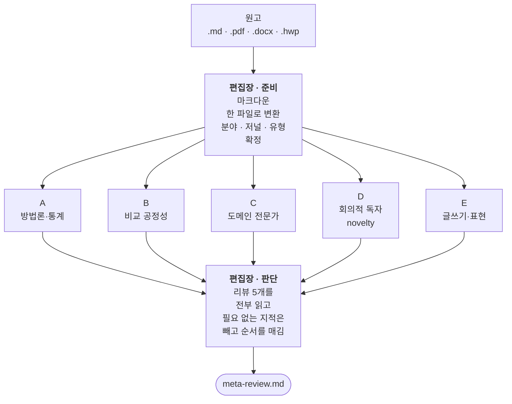

# reviewer-team

**Claude Code 안에서 돌리는 5인 피어리뷰 패널**

[English](README.md) | 한국어

- 저널 심사처럼 원고를 본다. 리뷰어 5명이 따로 읽고, 편집장 1명이 결과를 정리한다
- 편집장은 Claude다. 리뷰어는 서브에이전트로 동시에 돌고, 서로의 리뷰를 보지 않는다
- 결과는 메타리뷰 하나로 받는다. 무엇부터 고칠지 Blocker → Major → Minor 순으로 정리돼 있다
- 분야, 원고 유형, 투고 저널에 맞춰 심사 기준이 바뀐다
- 리뷰는 한국어로 쓴다. 영어 원고여도 마찬가지이고, 인용문·용어·수치는 원문 그대로 둔다
- 학술지 논문 말고도 학위논문, 연구계획서, 학회 초록에 쓸 수 있다

## 설치

```bash
npx skills add ByunghoChae/reviewer-team
```

또는 `skills/reviewer-team/` 폴더를 `~/.claude/skills/` 에 복사한다. 설치한 뒤 Claude Code를 다시 켠다.

## 바로 써보기

1. 원고가 있는 폴더에서 Claude Code를 연다
2. `/reviewer-team manuscript.md` 를 입력한다
3. 질문 두 개에 답한다: 원고 유형, 투고할 저널. 저널을 아직 못 정했으면 추천하는 3곳 중에서 고른다
4. 끝나면 `reviews/round-01/meta-review.md` 를 연다

원고 유형과 저널을 같이 적으면 묻지 않고 바로 시작한다.

```
/reviewer-team manuscript.md Meta-analysis, <저널명>
```

명령어 대신 말로 해도 된다. "투고 전에 봐줘", "reject 당할 만한 데 있나" 같은 말에도 뜬다.

## 어떻게 돌아가나



- 편집장은 원고를 직접 심사하지 않는다. 올라온 지적 중 무엇이 중요한지 고르는 게 일이다
- 리뷰어 5명은 같은 파일을 읽고 같은 분야·저널·유형 정보를 받는다. 그래야 리뷰끼리 비교할 수 있다
- 분야는 편집장이 정한다. 원고 유형과 저널은 사용자가 고른다

| 리뷰어 | 보는 것 |
|---|---|
| A · 방법론·통계 | 재현성, 실험 통제, 통계적 유의성, 정보 누수 |
| B · 비교 공정성 | 대조군·베이스라인 선정, 과장된 주장 |
| C · 도메인 전문가 | 분야 내 타당성, 누락 문헌, 한계 서술 |
| D · 회의적 독자 | 논리 공백, novelty, 대안 설명, 결과 포장(spin) |
| E · 글쓰기·표현 | 구조, 그림·표, 표준 용어와 용어 일관성 |

## 받는 결과

```
reviews/round-01/
├── reviewer-methodology.md
├── reviewer-fairness.md
├── reviewer-domain.md
├── reviewer-novelty.md
├── reviewer-writing.md
└── meta-review.md        ← 이것부터 읽는다
```

| `meta-review.md` 항목 | 알려주는 것 |
|---|---|
| 종합 판정 | Accept / Minor Revision / Major Revision / Reject, 리뷰어별 판정 |
| 핵심 주장 | 이 논문의 핵심 주장 한두 문장. 모든 지적을 이것에 비춰 판단한다 |
| 합의된 지적 | 리뷰어 2명 이상이 각자 찾아낸 문제 |
| 쟁점 | 리뷰어 판단이 갈린 곳과, 편집장이 어느 쪽이 맞다고 보는지와 그 이유 |
| 수정 우선순위 | Blocker / Major / Minor. 항목마다 어디를 고치는지, 추가 실험이 드는지 |
| 저자 대응 메모 | 반박해도 되는 지적과, rebuttal 에서 어떻게 답할지 |

## 고친 뒤 다시 심사받기

원고를 고치고 다시 심사를 요청하면 결과가 `round-02` 에 쌓인다. 편집장이 지난 라운드의 Blocker 를 하나씩 대조해 해결 / 부분해결 / 미해결로 표시한다.

리뷰어는 이전 라운드를 보지 않는다. 그래야 지난 지적만 확인하고 끝내지 않고 새 문제를 찾는다.

## 원고 형식

| 가진 파일 | 처리 |
|---|---|
| `.md`, `.txt` | 그대로 쓴다 |
| `.pdf` | 변환 도구를 먼저 묻는다: `pdf-inspector`(빠름, 텍스트 PDF) 또는 `minerU`(느림, 스캔본·수식) |
| `.docx` | `docx` 스킬로 변환 |
| `.hwp`, `.hwpx` | `hwpx-skill` 스킬로 변환 |
| 대화창에 붙여넣은 글 | `manuscript.md` 로 저장 |

변환본은 원고 옆에 `manuscript-normalized.md` 로 저장된다. 변환 도구는 별도 스킬이라, 필요한 스킬이 없으면 마크다운으로 직접 바꿔서 넘긴다.

원고 옆에 `references.bib` 나 보충자료가 있으면 리뷰어에게 같이 넘긴다. 초안 이력, 메모, 분석 스크립트, 로그는 넘기지 않는다. 피어리뷰는 논문만 보고, 논문이 만들어진 과정은 보지 않는다.

## 하지 않는 것

- 교정·윤문·번역만 하는 일. 이건 글쓰기 도구를 쓴다
- 이미 받은 리뷰에 대한 답변서(rebuttal letter) 작성
- 투고 직전에 채우는 정보 평가: 저자, 소속, 연구비, 이해상충, 윤리 승인번호, DOI 등. 비어 있거나 `[추후 기입]` 으로 남아 있어도 감점하지 않는다. 방법·결과의 공백은 여전히 지적한다
- 저널 서열 매기기. 저널 추천은 주제 범위와 원고 유형만 보고 하며, IF 같은 수치는 확인한 것만 적는다

## 상세 기준

심사 기준을 자세히 알고 싶은 사람을 위한 절이다. 정본은 [`skills/reviewer-team/SKILL.md`](skills/reviewer-team/SKILL.md) 다.

### 리뷰어 공통 규칙

- Major Issue 마다 근거 위치(섹션·표·그림·수식)를 적고, 수정가능 / 추가실험필요 / 해결불가 중 하나를 붙인다
- 확실하지 않은 지적은 "추측"이라고 표시한다. 원고에 없는 내용을 있다고 가정하지 않는다
- 아래 세 가지를 모두 만족하는 코멘트만 남긴다
  1. 저자가 원고의 특정 위치를 고치게 되거나, 게재 판정이 달라진다
  2. 원고가 실제로 주장하고 수행한 범위 안의 문제다
  3. 그 리뷰어의 심사 축에 속한다
- 쓰지 않는 것: 고칠 위치가 없는 "명확히 해달라", 주장에 필요 없는 추가 실험 요구, 향후 연구 제안, 취향 차원의 문체 지적, 잘된 점 나열
- 리뷰어당 Major 5개, Minor 5개, Questions 3개가 상한이다
- 판정: Accept / Minor Revision / Major Revision / Reject

### 편집장의 분류 기준

| 물음 | 분류 |
|---|---|
| 이 조치 없이는 핵심 주장이 성립하지 않거나, 투고처에서 리젝 사유가 되는가 | Blocker |
| 하면 판정이 한 단계 오르는가 | Major |
| 판정은 그대로지만 원고가 분명히 나아지는가 | Minor |
| 어느 것도 아니다 | 제외 (개수만 보고) |

여러 리뷰어가 같은 지적을 했다는 건 그 지적이 사실이라는 근거일 뿐, 조치가 필요하다는 근거는 아니다. 추가 실험이 드는 조치는 그만큼 필요성이 분명해야 Blocker·Major 에 오른다.

### 분야별 추가 기준

편집장이 분야를 한 번 정하고, 해당 리뷰어에게 아래 항목을 덧붙인다.

| 분야 | 추가로 보는 것 |
|---|---|
| ML·전산 | 기본 기준. 투고 학회가 있으면 그 학회의 재현성·윤리 서술 요구 |
| 생명·수의·농생명 | 실험단위와 분석단위 일치(의사반복), 대조구, 결과 수치의 통상 범위, 기전의 타당성, ARRIVE 2.0 / CONSORT / REFLECT / STROBE / PRISMA 2020, 사료 배합비 계산치 vs 실측치 |
| 의학·임상 | 무작위배정·배정은폐·눈가림, 표본수 근거, ITT vs per-protocol, 결과변수 사전 지정, 절대위험 vs 상대위험, CONSORT / STROBE / PRISMA |
| 화학·재료 | 합성 조건의 재현성, 특성분석 충분성, 대조 실험, 원료 순도·출처, 검출한계, 원자료(스펙트럼) |
| 사회과학·설문 | 표본 추출과 대표성, 응답률, 척도 신뢰도·타당도, 횡단자료로 인과를 말하는지 |
| 그 외 | 편집장이 그 분야의 리젝 사유 3–5개를 직접 만들거나, 분야 특화 기준을 적용하지 않았다고 밝힌다 |

### 원고 유형별 추가 기준

| 유형 | 추가로 보는 것 |
|---|---|
| Research Article | 기본 기준 |
| Meta-analysis (체계적 문헌고찰 포함) | 검색 재현성, 사전 선정기준, 2인 독립 선별·추출, 효과크기·SD 변환, 이질성(I²·τ²·예측구간), 효과크기 의존성, 출판편향·민감도 분석, 비뚤림 평가 도구, GRADE, PRISMA 2020 |
| Review (서술적 리뷰) | 문헌을 찾고 고른 방법, 상충 결과의 균형, 핵심·최신 문헌, 나열을 넘는 종합 틀, 근거 강도를 넘지 않는 결론 |

## 라이선스

MIT
