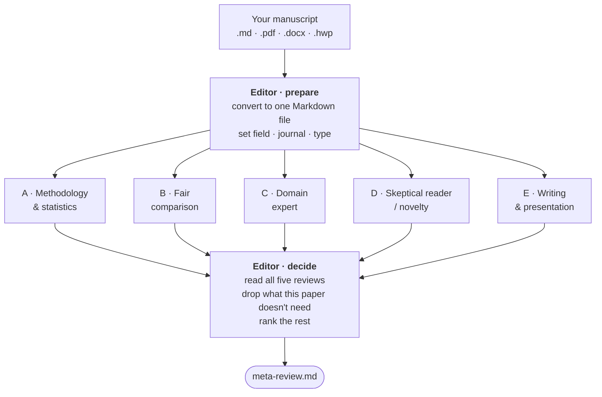

# reviewer-team

**A five-reviewer peer-review panel for your paper, inside Claude Code**

English | [한국어](README.ko.md)

- Reviews a manuscript the way a journal does: five reviewers read it separately, one editor sorts the results
- Claude is the editor. The reviewers run in parallel as subagents and never see each other's reviews
- You get one meta-review that says what to fix first, ranked Blocker → Major → Minor
- The criteria adapt to your field, your manuscript type, and your target journal
- Reviews are written in Korean, even for English manuscripts. Quotes, terms, and numbers stay in the original
- Also works for theses, research proposals, and conference abstracts

## Install

```bash
npx skills add ByunghoChae/reviewer-team
```

Or copy `skills/reviewer-team/` into `~/.claude/skills/`. Restart Claude Code after installing.

## Quick start

1. Open Claude Code in the folder that holds your manuscript
2. Type `/reviewer-team manuscript.md`
3. Answer two questions: the manuscript type, and the target journal. No journal yet? Pick one of the three it suggests
4. When it finishes, open `reviews/round-01/meta-review.md`

Name the type and journal up front and it starts without asking:

```
/reviewer-team manuscript.md Meta-analysis, <journal name>
```

You can also just ask in plain words: "review this before I submit", "is there anything that could get this rejected?"

## How it works



- The editor does not review the paper itself. Its job is deciding which comments matter
- All five reviewers read the same file and get the same field, journal, and type, so their reviews can be compared
- The editor sets the field. You choose the manuscript type and the journal

| Reviewer | Looks at |
|---|---|
| A · Methodology & statistics | Reproducibility, experimental control, significance, data leakage |
| B · Fair comparison | Choice of controls and baselines, overstated claims |
| C · Domain expert | Soundness in the field, missing literature, limitations |
| D · Skeptical reader | Logical gaps, novelty, alternative explanations, spin |
| E · Writing & presentation | Structure, figures and tables, standard and consistent terminology |

## What you get

```
reviews/round-01/
├── reviewer-methodology.md
├── reviewer-fairness.md
├── reviewer-domain.md
├── reviewer-novelty.md
├── reviewer-writing.md
└── meta-review.md        ← read this first
```

| `meta-review.md` section | What it tells you |
|---|---|
| Overall verdict | Accept / Minor Revision / Major Revision / Reject, plus each reviewer's verdict |
| Core claim | The paper's main claim in one or two sentences. Every comment is judged against it |
| Agreed issues | Problems that two or more reviewers found on their own |
| Disputes | Where reviewers disagreed, and which side the editor takes and why |
| Revision priorities | Blocker / Major / Minor, each with where to fix it and whether it needs new experiments |
| Rebuttal notes | Comments you can push back on, and how to answer them |

## Revise and review again

Ask for another review after revising and the output goes to `round-02`. The editor checks every Blocker from the last round: resolved, partly resolved, or unresolved.

The reviewers do not see the previous round. That way they look for new problems instead of only rechecking old ones.

## Manuscript formats

| You have | What happens |
|---|---|
| `.md`, `.txt` | Used as is |
| `.pdf` | It asks which converter to use: `pdf-inspector` (fast, text PDFs) or `minerU` (slow, handles scans and equations) |
| `.docx` | Converted with the `docx` skill |
| `.hwp`, `.hwpx` | Converted with the `hwpx-skill` skill |
| Text pasted into the chat | Saved as `manuscript.md` |

The converted file is saved next to your manuscript as `manuscript-normalized.md`. Converters are separate skills; if you don't have the one you need, convert the file to Markdown yourself first.

A `references.bib` or supplementary files next to the manuscript go to the reviewers too. Drafts, notes, analysis scripts, and logs do not. Peer review sees the paper, not how it was made.

## What it does not do

- Proofreading, polishing, or translation on their own. Use a writing tool for that
- Writing a rebuttal letter for reviews you already received
- Judging details you fill in at submission: authors, affiliations, funding, conflicts of interest, ethics approval numbers, DOI. Blanks and placeholders like `[TBD]` don't count against you. Gaps in methods or results still do
- Ranking journals by prestige. Suggestions are based on scope and article type only, and impact factors appear only when verified

## Reference

How reviews are judged, in detail. The source of truth is [`skills/reviewer-team/SKILL.md`](skills/reviewer-team/SKILL.md).

### Rules every reviewer follows

- Each Major Issue names its location (section, table, figure, equation) and is tagged: fixable by revision / needs new experiments / not fixable
- Uncertain points are marked as guesses. Nothing is assumed to be in the paper that isn't there
- A comment is kept only if all three hold:
  1. It makes the author change a specific place, or it changes the verdict
  2. It is within what the paper actually claims and did
  3. It belongs to that reviewer's area
- Left out: "please clarify" with nothing to fix, extra experiments the claim doesn't need, future-work ideas, style preferences, lists of strengths
- At most 5 Major Issues, 5 Minor Issues, and 3 Questions per reviewer
- Verdict: Accept / Minor Revision / Major Revision / Reject

### How the editor sorts comments

| Question | Goes to |
|---|---|
| Without this fix, does the core claim fail, or would the journal reject it? | Blocker |
| Would this fix raise the verdict by one step? | Major |
| Same verdict, but a clearly better paper? | Minor |
| None of the above | Dropped (only the count is reported) |

When several reviewers agree, that shows a comment is true, not that the fix is needed. A fix that needs new experiments has to be clearly necessary to rank as Blocker or Major.

### Field-specific checks

The editor picks the field once and adds these checks for the relevant reviewers.

| Field | Extra checks |
|---|---|
| ML / computing | Default criteria, plus the target venue's reproducibility and ethics requirements |
| Life sciences, veterinary, animal & agricultural | Experimental unit vs. statistical unit (pseudoreplication), controls, values within normal ranges, plausible mechanisms, ARRIVE 2.0 / CONSORT / REFLECT / STROBE / PRISMA 2020, diet formulation calculated vs. analyzed |
| Medicine / clinical | Randomization, allocation concealment, blinding, sample size, ITT vs. per-protocol, pre-specified outcomes, absolute vs. relative risk, CONSORT / STROBE / PRISMA |
| Chemistry / materials | Reproducible synthesis conditions, enough characterization, controls, purity and source, detection limits, raw spectra |
| Social science / surveys | Sampling and representativeness, response rate, scale reliability and validity, causal claims from cross-sectional data |
| Other | The editor writes 3–5 field-specific reject reasons, or states that none were applied |

### Manuscript-type checks

| Type | Extra checks |
|---|---|
| Research Article | Default criteria |
| Meta-analysis (incl. systematic review) | Reproducible search, pre-set eligibility, dual screening and extraction, effect-size and SD conversion, heterogeneity (I², τ², prediction interval), dependent effect sizes, publication bias and sensitivity analysis, risk-of-bias tool, GRADE, PRISMA 2020 |
| Review (narrative) | How literature was found and chosen, balanced handling of conflicting results, key and recent papers, a synthesis beyond listing, conclusions within the evidence |

## License

MIT
